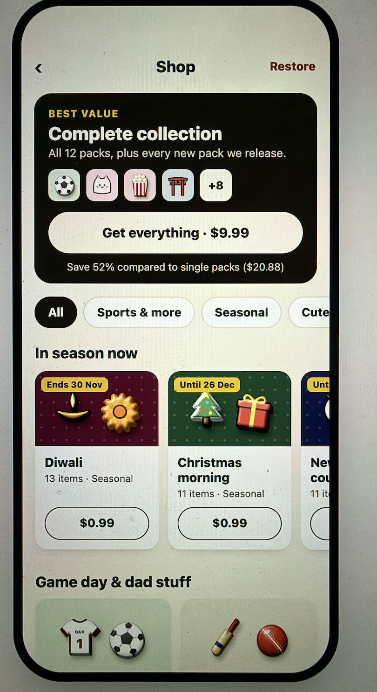

# Agent brief: the shop page (pack list)

Build the shop page in the app. This is the screen that lists the packs. The database controls everything on it. Read this whole file before you start.

Design reference: 

## Scope

- In scope: the shop list screen, its data (database flags and store prices), and what happens when a user taps a card or a button on it.
- Out of scope: the pack detail screen, the preview on the board, the Use on this fridge flow, the decorations tray, magnet art and baking.
- A tap on a card only navigates to the detail route `/shop/[packId]`. Make a placeholder screen if that route does not exist yet.

## Read first

- `AGENTS.md`: Expo rules, migration freeze, lint and typecheck.
- `docs/prd-magents-stickers.md`, sections 6.3, 6.4 and 9.1 (server-driven packs). The screenshot calls this file `prd-magnets-stickers-packs.md`; that file does not exist, and `prd-magents-stickers.md` is the one in the repo.
- `supabase/migrations/20261003000019_magnets_stickers.sql`: the current `pack_catalog`, `pack_art` and `user_entitlements` tables.
- `src/lib/api.ts` (`getPacks`, `getPackArt`, `boardCanUse`) and `src/types/index.ts` (`Pack`, `PackArt`).
- Visual reference: `docs/assets/pack-shop-collection.jpg` (screenshot of the shop list screen). Copy the layout, not the data.

## 0. Ground rules

- Do not run `git commit` or `git push`.
- Migration freeze: add one new migration. Never edit a migration that was already pushed. Never reset the hosted database.
- Prices come from the store (RevenueCat), not from the database. The database only says which store product to sell.
- Do not use `price_label` as the price on a button. Use it only as a fallback while the store prices load.
- Packs are data only. Do not add code for a specific pack. Do not test for a pack id in UI code.
- If a rule here is not possible or is wrong, stop. Write the problem in `docs/backend-plan-questions.md` under a new heading, Shop page. Do not guess.
- Before you say the task is done, run `npx expo lint`, `npx tsc --noEmit`, `node scripts/run-unit-tests.cjs` and the checks in section 6.

## 1. What the shop page shows (top to bottom)

### 1.1 Header

- Back button, the title Shop, and a Restore text button on the right.
- The Restore button must always be visible. This is an App Store rule.

### 1.2 Collection offer

- A dark card with these parts:
  - A small label: BEST VALUE.
  - A title and one line of text.
  - 4 art tiles and a +N tile.
  - A button: Get everything · {price}.
  - A line under the button: Save {X}% compared to single packs.
- Data: the bundle pack that has `featured = true`.
- Hide the card when a filter other than All is selected.
- Hide the card when no featured bundle is visible.
- When the user owns every pack in `bundle_of`, change the button text to You own every pack and disable the button.

### 1.3 Filter chips

- The chips are All, then one chip for each category that has a `chip_label`, then Owned.
- All and Owned are fixed. The other chips come from the database.
- Show a category chip only when the category has at least 1 visible pack.
- The chip row scrolls sideways.

### 1.4 Category sections

- Each section has a title and the pack cards for that category.
- The layout comes from `shop_categories.layout`:
  - `grid`: 2 columns.
  - `row`: 1 row that scrolls sideways and snaps to each card (for example, In season now).
- Sort the sections by `shop_categories.sort`. Sort the packs in a section by `pack_catalog.sort`.

### 1.5 Pack card

- The art area has a background colour, 1 or 2 art images and an optional badge.
- Under the art: the pack name, then {N} items · {card tag}, then the price button.
- Section 5 gives the card states.

### 1.6 Footer

- Fixed text: One-time purchases. Shared with everyone on the board and with Family Sharing. All art is original to Fridge Board.

### 1.7 Owned chip

- When the Owned chip is selected, show one section, Your packs.
- It contains every pack the user's boards can use: free packs and packs with an entitlement.
- Include packs that are retired or past `available_until`. Owners keep their packs forever (PRD P-7).
- This is the only place where a hidden pack can show.

### 1.8 Empty and error states

- A filter has no packs: show Nothing here yet.
- The catalogue did not load and there is no cache: show Couldn't load the shop. Check your connection. Under it, show a Try again button.

## 2. Database changes (one new migration)

Name it with the next free number, for example `supabase/migrations/20261123000023_shop_flags.sql`. That number is free as of this brief: the newest existing migration is `20261007000022_moderation_fixes.sql` and no `shop_flags` migration exists. Before you create it, run `ls supabase/migrations` and confirm the exact filename does not exist; if it does, take the next free number. Never edit, rename or renumber an existing migration.

```sql
-- Categories = the sections and chips on the shop page.
create table public.shop_categories (
  id              text primary key,
  title           text not null,             -- section title
  chip_label      text,                      -- chip text; null = no chip
  card_tag        text,                      -- tag on each card in this category
  layout          text not null default 'grid' check (layout in ('grid', 'row')),
  sort            integer not null default 100,
  status          text not null default 'draft' check (status in ('draft', 'live', 'retired')),
  available_from  timestamptz,
  available_until timestamptz
);

alter table public.pack_catalog
  add column category_id           text references public.shop_categories (id),
  add column featured              boolean not null default false,  -- bundle shown in the collection offer
  add column card_art              text[],     -- 1 or 2 art_ids for the card; null = first 2 live magnets
  add column card_bg               text,       -- hex colour for the card art area
  add column card_tag              text,       -- overrides the category card_tag
  add column badge_text            text,       -- overrides the automatic end-date badge
  add column sale_store_product_id text,       -- discounted store product (see section 4)
  add column sale_from             timestamptz,
  add column sale_until            timestamptz,
  add column sale_label            text,       -- optional; null = computed percent off
  add column regions               text[];     -- ISO country codes; null = every country

alter table public.pack_art
  add column status text not null default 'live' check (status in ('draft', 'live', 'retired')),
  add column sort   integer not null default 100;
```

- RLS: signed-in users can read `shop_categories` rows where `status = 'live'`.
- Keep the current read rules on `pack_catalog` and `pack_art`.
- Draft rows are visible only to test accounts on the allow-list (PRD section 9.1). Use the existing allow-list if there is one. If there is none, ask in `docs/backend-plan-questions.md`.
- Add pgTAP tests in `supabase/tests/`. Use `19_magnets_stickers.test.sql` as the example.
- Seed rows for the categories shown in the design reference in `supabase/seed.sql` only (local database).
- Do not write catalogue rows to the hosted database. That is a separate admin-script task.

## 3. Visibility rules (one function, on the server)

Add an RPC: `get_shop(p_renderer integer, p_region text)`. It returns the categories and packs that the shop must show, already filtered and sorted. The app does no filtering of its own, except for the Owned chip.

### 3.1 Visible pack

A pack is visible only when all of these are true:

1. `status = 'live'`, or `status = 'draft'` and the caller is on the test allow-list.
2. `now()` is between `available_from` and `available_until`. A null value means no limit.
3. `min_renderer` is less than or equal to `p_renderer`.
4. `regions` is null, or `regions` contains `p_region`.
5. Its category is visible (rules 1, 2 and 4, applied to `shop_categories`).
6. It is not a bundle. The one exception is a featured bundle, which is returned for the collection offer.

### 3.2 Visible category

A category is visible when it passes rules 1, 2 and 4, and it has at least 1 visible pack.

### 3.3 Item count on the card

- Count the `pack_art` rows of the pack where `status = 'live'` and `kind` is magnet, sticker or paper.
- Doors and fasteners are not counted.
- The server returns this number. Do not hard-code it in the app.

### 3.4 Packs that need a newer app

- If a pack is hidden only because of rule 3, add it to `hidden_for_update`.
- When `hidden_for_update` is more than 0, show one line above the footer: Update the app to see {n} new packs.

### 3.5 Return shape (suggested)

```json
{
  "categories": [
    { "id": "dad", "title": "Game day & dad stuff", "chipLabel": "Sports & more", "layout": "grid" }
  ],
  "packs": [
    {
      "id": "football", "categoryId": "dad", "kind": "theme", "name": "Matchday football",
      "storeProductId": "…", "saleStoreProductId": null, "saleUntil": null, "saleLabel": null,
      "priceLabel": "$1.99", "availableUntil": null, "badgeText": null,
      "cardArt": ["fb_jersey", "fb_ball"], "cardBg": "#DDEFD9", "cardTag": "Sport",
      "itemCount": 15, "bundleOf": null, "featured": false
    }
  ],
  "hiddenForUpdate": 0
}
```

### 3.6 App side

- Keep `getPacks()` working for the code that already uses it.
- Add a new `getShop()` function in `src/lib/api.ts`.
- Cache the last result on the device. On the next open, show the cache first, then refresh (PRD section 9.1).

## 4. Price and discount

### 4.1 Price

- Get the price from RevenueCat with `storeProductId`.
- While the prices load, show `priceLabel` with a loading shimmer.
- If the store has no price for a paid pack (for example, the product is not approved yet), hide that pack. Log it in development builds.
- A free pack shows Free on its button.

### 4.2 Discount

- A pack is on sale when `sale_store_product_id` is set and `now()` is between `sale_from` and `sale_until`.
- During a sale, sell the sale product.
- The button shows the sale price. Next to it, show the normal price with a line through it.
- The badge shows `sale_label`. If `sale_label` is null, the badge shows {X}% off.
- Calculate X from the two store prices and round it down.
- If the sale product has no store price, show the normal price and no discount.

### 4.3 Collection offer saving

- Save % = 1 − (bundle price ÷ sum of the store prices of the packs in `bundle_of` that the user does not own yet).
- Round it down.
- Hide the line when the result is less than 5%.

## 5. Card states and actions

### 5.1 Locked

- Condition: the user has no entitlement and the pack is not free.
- Button: the price, outlined.
- Tap on the button: start the store purchase (RevenueCat).

### 5.2 On sale

- Condition: locked, and a sale is active.
- Button: the sale price, and the normal price with a line through it, outlined.
- Tap on the button: purchase the sale product.

### 5.3 Owned

- Condition: `boardCanUse` is true, and the pack is not the board's `theme_pack`.
- Button: Use, yellow fill.
- Tap on the button: go to the detail screen.

### 5.4 In use

- Condition: the board's `theme_pack` is this pack.
- Button: In use, green fill.
- Tap on the button: go to the detail screen.

### 5.5 Other rules

- A tap anywhere else on the card opens `/shop/[packId]`.
- Badge in the top-left of the art area. Use the first rule that matches:
  1. `badge_text`.
  2. The sale badge.
  3. Until {d MMM}, when `available_until` is within 60 days. Format the date with the phone's locale.
- After a purchase or a restore, fetch the entitlements again and update the cards. Do not reload the full screen.
- After a purchase, show a toast: {Pack} is yours.
- Offline:
  - Show the cached shop.
  - Disable the price buttons and the Get everything button.
  - Show You're offline.
  - The Restore button still works. If it fails, show an error toast.

## 6. Checks before you say it is done

1. A new category with `status = 'live'` and 1 live pack shows a section and a chip, with no app change. Set the category to draft: the section and the chip go away.
2. A pack with `available_until` in the past is not in All. It is in Owned for a user who owns it.
3. Set 1 magnet of a pack to `pack_art.status = 'retired'`. The item count on the card goes down by 1.
4. A sale with a valid sale product shows the line-through price and {X}% off. X agrees with the two store prices. After `sale_until`, the normal price shows again on the next shop open.
5. A pack with `min_renderer` higher than the app's renderer is hidden, and the Update the app line shows.
6. The Restore button is visible in every state: loading, offline, empty and error.
7. Accessibility:
   - Every card has one accessibility label, for example: Matchday football, 15 items, $1.99.
   - Every tap target is at least 48 × 48 pt.
   - Text grows with the system font size. At the largest sizes, the 2-column grid changes to 1 column.
8. `npx expo lint`, `npx tsc --noEmit`, the unit tests and the pgTAP tests all pass.

At the end, write a short summary: the files you changed, the migration name and the open questions you added.
